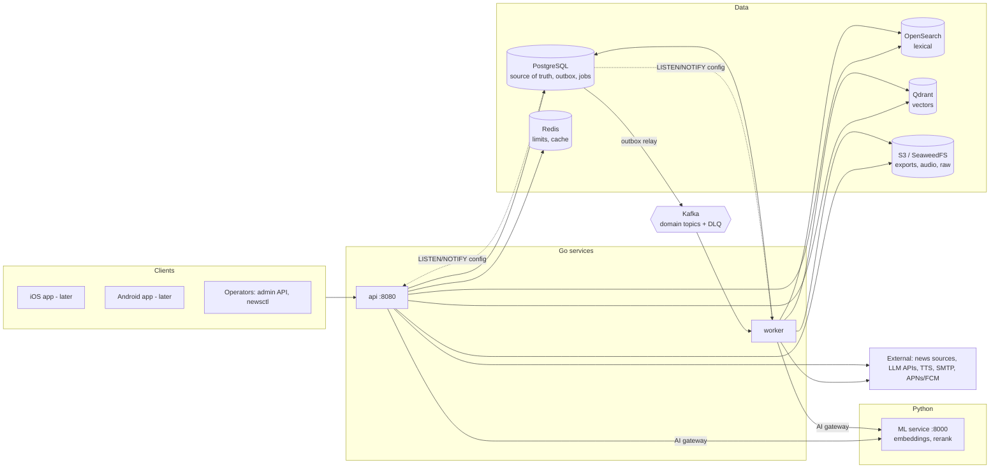
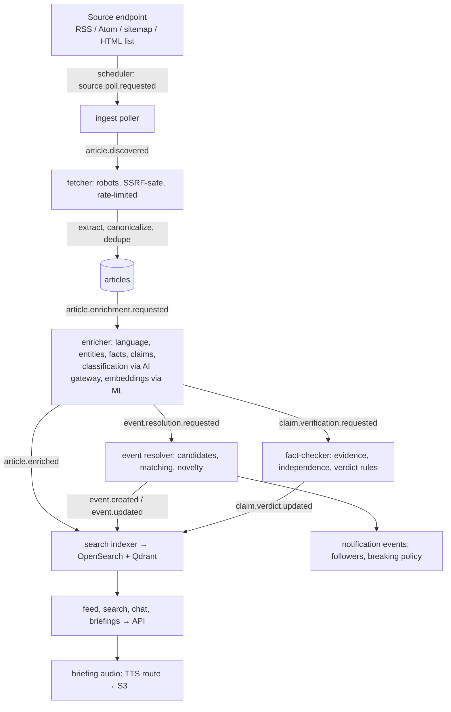

# Architecture

## Shape

One Go module with five binaries sharing the same domain packages, plus a Python ML service:

| Component | Role |
|---|---|
| `cmd/api` | HTTP API (`:8080`) and an internal metrics listener (`ADMIN_HTTP_ADDR`, default `:9090`) |
| `cmd/worker` | Bus consumers, durable job runner, mail delivery, source scheduler, notification scheduler, TTL cleanup |
| `cmd/migrate` | Applies embedded goose migrations |
| `cmd/newsctl` | Operator CLI: seed, create-admin, bootstrap-admin, ingest-fixtures, verify-sources, drain, reindex, replay-dead-letter, eval |
| `cmd/loadtest` | Read-path load generator with latency thresholds |
| `services/ml` | Python FastAPI service: multilingual embeddings (BGE-M3), cross-encoder reranking, classification and NER experiments, retrieval evaluation (ADR-021) |

`internal/app` assembles the infrastructure (DB, Redis, storage, mail, bus) and the modules. API
and worker are separate processes over the same PostgreSQL database; they scale independently.



Data flow for one article (topics are outbox event types):



## Principles

1. **PostgreSQL is the source of truth.** Search indices and vector collections are derived and can
   be rebuilt from canonical rows (`newsctl reindex`, `POST /v1/admin/search/reindex`). No pgvector.
2. **Transactional outbox.** Every state change that others react to writes an `outbox_events` row
   in the same transaction. The bus driver relays it (Kafka) or queues it (`message_deliveries`,
   `SKIP LOCKED`). Consumers are idempotent (`consumer_dedupe`, `Delivery.Once`), so at-least-once
   delivery never duplicates articles, events or claims (verified against a real broker).
3. **Durable jobs** (`jobs` table) for long-running, retriable work: reclassification, reindex,
   vector backfill, reprocessing, briefing and audio generation, data export and deletion. Jobs
   hold a lease renewed by a heartbeat; outcomes are fenced on the lease owner and attempt, so a
   stalled worker can never overwrite a newer run, and running jobs can be cancelled. Temporal was
   evaluated and not adopted (ADR-020).
4. **Dynamic configuration.** Sources, categories, AI providers, models, routes, prompts, editorial
   policies and feature flags are database rows managed through audited admin APIs. Writes notify
   every process through PostgreSQL `LISTEN/NOTIFY`, so changes apply without restarts (ADR-023).
5. **Business logic stays in Go.** The ML service is a stateless model server behind the AI
   gateway: it returns vectors and scores, never decisions. Classification, event matching,
   verdicts and ranking live in Go, so models can be swapped through routes without touching domain
   code (ADR-021).
6. **Honest degradation.** Missing providers or infrastructure produce explicit states
   (`provider_unavailable`, `degraded: [...]`, deferred AI tasks), never fabricated output.
7. **Untrusted content.** Crawled text is data. Prompts fence it, outputs are schema-validated,
   citations are mapped server-side to retrieved documents only, and fetches are SSRF-checked at
   validation and dial time.

## Module map

| Package | Responsibility |
|---|---|
| `identity` | Registration, OTP verification, login, refresh rotation, sessions, password reset, email change, export and deletion, RBAC middleware |
| `sources` | Publishers, permissions (content rights), endpoints, extraction profiles, crawl runs, health, blocklist |
| `ingest` | Scheduling, polite fetching (robots, rate limits), feed parsing, HTML extraction, canonicalization, dedupe, revisions, moderation |
| `taxonomy` | Category tree, versions, merges and redirects, reclassification requests |
| `enrich` / `nlp` | Language, entities (gazetteer), facts (numbers, dates, decisions), claims, classification via the AI gateway |
| `ai` | Gateway, routes and fallbacks, providers, prompts, schemas, budgets, executions, admin, Langfuse observer |
| `events` | Candidate retrieval, matching, event creation and update, novelty, synthesis, versions, timeline, editorial operations |
| `search` | Lexical (OpenSearch or PostgreSQL FTS), vectors (Qdrant or in-memory), hybrid query, collections and migrations |
| `factcheck` | Evidence retrieval, independence, verdict rules, review workflow, publishing, corrections, narratives, trends |
| `feed` | Preferences, interests, follows, ranking, feed pagination, catch-up |
| `briefings` / `chat` / `notifications` | Experience modules |
| `eval` / `analytics` / `policy` / `audit` / `jobs` / `mail` | Cross-cutting services |
| `apispec` | OpenAPI generation from Go types; contract tests keep it aligned with the router |

## Request path

`RequestID → logger → recoverer → tracing → access log → security headers → CORS → body limit →`
`Authenticate (JWT or service key) → RequireUser / Require(permission) → handler`.
Errors are rendered once by `httpx.WriteError` as RFC 9457 problems; 5xx are logged with the
request id, 4xx are not (no credential or content leakage in logs).

## Processing path

```
source.poll.requested → ingest-poller → article.discovered → ingest-fetcher → article persisted
  → article.enrichment.requested → enricher → article.enriched ─┬─▶ search-indexer
                                                                 ├─▶ fact-checker (new primary evidence → re-verify)
  → event.resolution.requested → event-resolver → event.created / event.updated
        ├─▶ search-indexer        ├─▶ notification-events (followers, breaking policy)
  → claim.verification.requested → fact-checker → claim.verdict.updated → search-indexer, notification-events
```

Details: [event-processing.md](event-processing.md).

## Security model (summary)

- Only registration, verification, login, refresh, password reset, JWKS, health and the OpenAPI
  document are public. Every other endpoint requires an active, verified principal.
- Staff permissions are fine-grained (`sources:write`, `factcheck:publish`, …); review and publish
  of fact-checks are separate. The contract test checks every documented permission against the
  router.
- Secrets come from the environment and are validated at start (production refuses missing or
  unsafe settings). Provider API keys stored through the admin API are AES-GCM encrypted. Device
  tokens are stored HMAC-hashed and encrypted and never returned.
- Logs exclude credentials, tokens, device tokens and chat contents. Analytics are pseudonymous and
  limited to route patterns. The Langfuse exporter sends metadata only.
